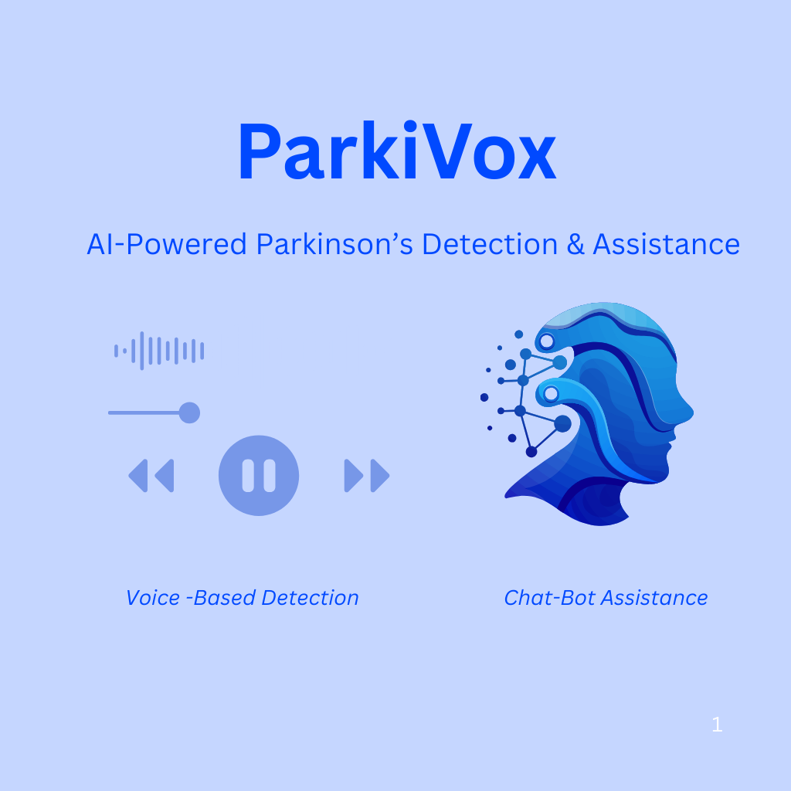

# 🧠 ParkiVox – Voice-Based Parkinson's Disease Prediction

<p align="center">
  
</p>

<h3 align="center">AI-Powered Voice Analysis for Early Parkinson's Disease Screening</h3>

<p align="center">
  
  
  
  
  
</p>

---

## 📌 About the Project

**ParkiVox** is an AI-powered, voice-based Parkinson's Disease prediction project that explores how speech characteristics can help identify patterns associated with Parkinson's Disease.

Parkinson's Disease is a progressive neurological condition that can affect movement, coordination, and speech. Changes in vocal characteristics, such as pitch variation, voice stability, and amplitude, may provide useful information for research and preliminary screening.

ParkiVox analyzes voice recordings, extracts relevant acoustic features, and uses a Machine Learning model to generate a prediction.

The project also provides a web-based interface and an AI-powered chatbot to make the system more interactive and accessible.

### 🎯 Project Objectives

- Explore voice-based analysis for Parkinson's Disease screening.
- Extract meaningful acoustic features from speech recordings.
- Apply Machine Learning techniques to classify voice patterns.
- Provide a simple web interface for audio recording and uploading.
- Present prediction results in an understandable format.
- Offer an AI-powered chatbot for Parkinson's-related information.

---

## ✨ Key Features

| Feature | Description |
|---|---|
| 🎙️ Voice Recording | Record voice samples directly through the web interface. |
| 📁 Audio Upload | Upload existing audio recordings for analysis. |
| 🔊 Audio Processing | Convert and preprocess audio files for feature extraction. |
| 📊 Feature Extraction | Analyze acoustic characteristics such as MFCC, jitter, shimmer, and pitch. |
| 🤖 ML Prediction | Use a Random Forest classification model for voice-based prediction. |
| 📈 Result Visualization | Display prediction results and supporting analysis. |
| 💬 AI Chatbot | Provide Parkinson's-related information through an interactive chatbot. |
| 🧠 Gemini Integration | Use Google Gemini API for AI-powered conversational responses. |
| 📥 Feature Export | Support downloading extracted voice features. |

---

## ⚙️ Technology Stack

### Backend
- Python
- Flask
- Flask-CORS
- Werkzeug

### Machine Learning & Audio Processing
- Scikit-learn
- NumPy
- Pandas
- PyDub
- FFmpeg
- Audio feature extraction techniques

### Artificial Intelligence
- Google Gemini API
- Google Gen AI SDK

### Frontend
- HTML5
- CSS3
- JavaScript

### Tools
- Visual Studio Code
- Git
- GitHub
- Python Virtual Environment

---

## 🔍 How ParkiVox Works

The application follows a voice-processing and prediction workflow.

1. **Audio Input:** The user records their voice or uploads an existing audio file.
2. **Audio Preprocessing:** The audio is converted into a suitable WAV format and standardized for analysis.
3. **Feature Extraction:** Acoustic characteristics are extracted from the audio.
4. **Machine Learning:** The extracted features are passed to the trained Random Forest model.
5. **Prediction:** The system generates a classification result.
6. **Result Display:** The result is presented through the web interface.
7. **AI Assistance:** Users can interact with the chatbot to learn more about Parkinson's Disease.

### Acoustic Features

The project explores several voice characteristics, including:

- **MFCC (Mel-Frequency Cepstral Coefficients):** Represents important spectral characteristics of speech.
- **Jitter:** Measures variations in fundamental voice frequency.
- **Shimmer:** Measures variations in voice amplitude.
- **Pitch:** Represents the perceived frequency of the voice.
- **Zero Crossing Rate:** Measures how frequently a signal crosses the zero-amplitude line.

---

## 🏗️ Project Structure

The current repository contains the following major files:

```text
PARKIVOX/
│
├── app.py
├── app.js
├── index.html
├── style.css
│
├── feature_extraction.py
├── predict_audio.py
├── voice.py
├── voice_model.py
├── chatbot.py
├── check.py
├── type.py
├── generate_plots.py
│
├── voice.html
├── voice.css
├── voice.js
│
├── chatbot.html
├── chatbot.css
├── chatbot.js
│
├── result.html
├── result.css
│
├── parkinsons.data
├── full_set.csv
├── parkinson_model.pkl
├── scaler.pkl
│
├── brain.png
├── parki_logo.png
├── confusion_matrix.png
├── feature_importance.png
├── roc_curve.png
│
├── requirements.txt
├── .env
└── README.md
```

*Note: The repository also contains sample audio recordings and additional assets that are not all listed above.*

---

## 🚀 Installation and Setup

Follow these steps to run ParkiVox locally.

### 1. Clone the Repository

```bash
git clone https://github.com/sirii-18/PARKIVOX.git
```

### 2. Navigate to the Project Folder

```bash
cd PARKIVOX
```

### 3. Create a Virtual Environment

```bash
python -m venv venv
```

### 4. Activate the Virtual Environment

**Windows:**

```bash
venv\Scripts\activate
```

**Linux / macOS:**

```bash
source venv/bin/activate
```

### 5. Install Dependencies

```bash
pip install -r requirements.txt
```

### 6. Configure Environment Variables

Create a `.env` file in the project root directory.

```env
API_KEY=your_google_gemini_api_key
```

Replace the placeholder with your own Google Gemini API key.

Keep API keys private. Never upload real credentials to GitHub.

### 7. Install FFmpeg

ParkiVox uses FFmpeg for audio conversion and processing through PyDub.

Install FFmpeg and configure its executable path so that it is accessible from your system.

### 8. Run the Application

```bash
python app.py
```

Open your browser and visit:

```text
http://127.0.0.1:5000
```

---

## 📊 Machine Learning Model

ParkiVox uses a **Random Forest Classifier** to analyze extracted acoustic features and generate a prediction.

| Component | Description |
|---|---|
| Algorithm | Random Forest Classifier |
| Input | Extracted voice features |
| Output | Classification result |
| Model | `parkinson_model.pkl` |
| Scaler | `scaler.pkl` |

The repository also includes model evaluation and visualization assets, such as:

- Confusion Matrix
- ROC Curve
- Feature Importance

These visualizations help examine the model's classification performance and the contribution of different features.

---

## 💬 AI-Powered Chatbot

ParkiVox includes an interactive chatbot that helps users understand Parkinson's Disease.

The chatbot provides:
- General information about Parkinson's Disease.
- Information about common symptoms.
- Educational responses about treatment and management.
- Conversational assistance using Google Gemini.

The chatbot is intended for educational purposes and does not replace professional medical advice.

---

## 📷 Project Screenshots

Add your actual application screenshots to a `screenshots/` directory and use the following references.

| Page | Preview |
|---|---|
| Home Page | `screenshots/home.png` |
| Voice Analysis | `screenshots/voice-analysis.png` |
| Prediction Result | `screenshots/result.png` |
| Chatbot | `screenshots/chatbot.png` |

To display an individual screenshot:

```markdown

```

---

## 🔮 Future Enhancements

- Improve prediction reliability using larger and more diverse voice datasets.
- Explore advanced deep learning architectures such as CNNs.
- Introduce multilingual voice analysis.
- Improve real-time audio processing.
- Enhance model evaluation and explainability.
- Add secure user authentication and recording management.
- Develop a responsive mobile-friendly interface.
- Provide longitudinal voice monitoring for research purposes.

---

## ⚠️ Medical Disclaimer

ParkiVox is an educational and research-oriented prototype. It is not a certified medical device and must not be used to diagnose, treat, or rule out Parkinson's Disease.

Voice-based predictions are experimental and may be inaccurate. Always consult a qualified healthcare professional for medical evaluation and diagnosis.

---

## 👩‍💻 Author

**Sirisha S**

AI & Machine Learning Enthusiast | Aspiring Software Developer

- GitHub: [@sirii-18](https://github.com/sirii-18)
- Project Repository: [PARKIVOX](https://github.com/sirii-18/PARKIVOX)

---

## ⭐ Support

If you find this project interesting, consider giving the repository a ⭐ on GitHub!

Your support and feedback are appreciated.

---

<p align="center">
  <b>ParkiVox – Exploring the Power of Voice and Artificial Intelligence 🧠🎙️</b>
</p>
